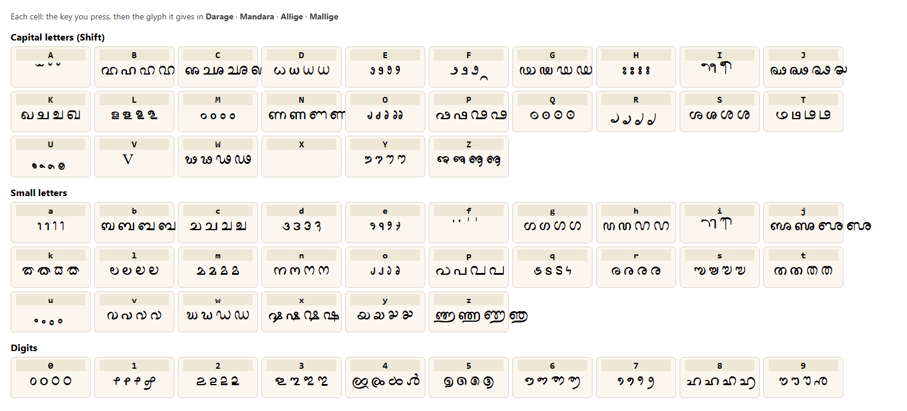
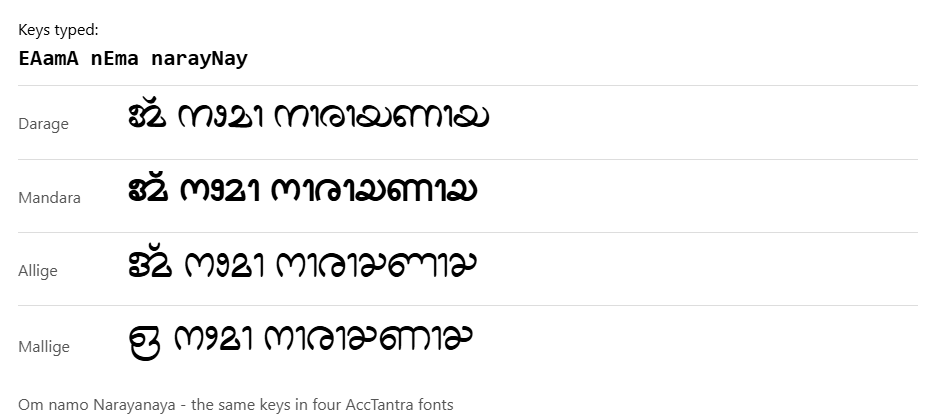

# AccTantra

**A single typing standard for every ASCII Tulu font.**

*Part of the [Tantry Tulu Font Foundry](https://github.com/TantryTuluFonts), by Prahlad Prasad Tantry.*

## What is AccTantra?

AccTantra is a typing standard for the Tulu language on ASCII-based fonts. You type with an ordinary keyboard, and an AccTantra font draws the Tulu letters. The same keystrokes work in every AccTantra font, so a text typed once can be shown in any of them.

The name is made of two words. *Accu* means to press or print, as in a printing press. *Tantra* means a text, theory, system, method or technique. Together, AccTantra means **"the doctrine of printing"**.

### Why it exists

Tulu is a Dravidian language with a rich history and culture, but support for its script in everyday software has been thin. Many ASCII Tulu fonts have been made over the years, each with its own idea of which key means which letter. Text typed for one font comes out as nonsense in another.

AccTantra fixes this at the keyboard level. Because every font follows the same key assignments, the underlying Latin text stays the same whichever font is applied on top.

## Quick start

1. Install an AccTantra font, for example one from the table below.
2. Choose that font in your editor or design tool.
3. Type using the keys in the [key chart](docs/KEYMAP.md).

**Example:** type `EAamA nEma narayNay`, and any AccTantra font shows *Om namo Narayanaya*:

## AccTantra fonts

These fonts all follow the AccTantra key assignments:

| Font | Style | Repository |
|---|---|---|
| Darage | OpenType (`.otf`), source available | [TantryTuluFonts/darage](https://github.com/TantryTuluFonts/darage) |
| Mandara | Bold, rounded | [TantryTuluFonts/mandara](https://github.com/TantryTuluFonts/mandara) |
| Allige | Academy edition | [TantryTuluFonts/allige](https://github.com/TantryTuluFonts/allige) |
| Mallige | Largest conjunct set | [TantryTuluFonts/mallige](https://github.com/TantryTuluFonts/mallige) |

The key chart above shows the same keys in all four, so you can compare how each one draws each letter.

## How the typing works

- **Letters on phonetic keys.** Keys are assigned by sound. Consonants sit on the Latin letter they most resemble, and aspirated or related consonants use the Shift version of the same key.
- **The virama (`A`).** The `A` key gives the virama, which cancels a consonant's inherent vowel. It also acts as a placeholder for a consonant, so that vowel signs can attach to it to form an independent vowel.
- **Conjuncts.** To join two consonants, type the first consonant, `A`, then the second. For example `kAt`. The font substitutes the joined shape automatically. See the [conjunct reference](docs/CONJUNCTS.md) for exactly which pairs each font supports.
- **Two-part vowels.** Some vowels are written around the consonant. In `nEma`, the `E` is typed before the consonant `m` and the `a` after it, and together they make the vowel *o*, giving *na-mo*.
- **Digits.** The digit keys `0` to `9` give Tulu-script numerals.
- **Other keys.** Punctuation and unassigned keys produce ordinary characters.

For the full key-by-key reference, see **[docs/KEYMAP.md](docs/KEYMAP.md)**.

## Documentation

| Page | What it covers |
|---|---|
| [Key map](docs/KEYMAP.md) | Every key, grouped by letter class, with the visual chart |
| [Conjunct reference](docs/CONJUNCTS.md) | Which consonant pairs each font joins, generated from the fonts |
| [Typing examples](docs/EXAMPLES.md) | Worked examples, keystroke by keystroke |

## Typing real Unicode instead

AccTantra is for ASCII fonts, where the text is stored as Latin characters. If you want to store Tulu as real Unicode text, the same typing logic is available as a keyboard:

- **[AccTantra_Unicode](https://github.com/PrahladTantry/AccTantra_Unicode)** is a Keyman keyboard for the Tulu-Tigalari script, following the AccTantra key logic.
- **[Mallige_unicode](https://github.com/PrahladTantry/Mallige_unicode)** is a Unicode font for the Tulu-Tigalari script, to display what the keyboard types.

## Goals

- **Make Tulu easy to type online.** Let people create and share Tulu text on websites, social media and documents.
- **Keep one standard.** Offer a single layout so that every present and future ASCII Tulu font is compatible.
- **Stay independent of the font.** The Latin text underneath never depends on which font is applied.
- **Support preservation.** Help document, study and revitalise the language in the digital era.
- **Enable cultural expression.** Give Tulu speakers a way to write their literature and traditions in their own script.

## Contributing

AccTantra is meant to be extended by the community. Corrections, additional fonts that follow the standard, and documentation fixes are all welcome. Please [open an issue](https://github.com/PrahladTantry/AccTantra/issues) to discuss a change.

## Author

Designed and maintained by **Prahlad Prasad Tantry** · [Tantry Tulu Font Foundry](https://github.com/TantryTuluFonts)
