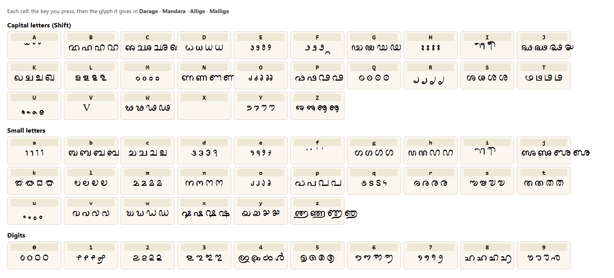

# AccTantra key map

Type with a normal keyboard; an AccTantra font draws the Tulu letters. This page lists what each key does.

The picture below shows every letter and digit key, and the glyph it gives in each AccTantra font (Darage, Mandara, Allige, Mallige, in that order). It is rendered from the fonts themselves.

## Consonants

Consonants sit on phonetic keys. The aspirated or related form is on the Shift key.

| Group | Keys | Letters |
|---|---|---|
| Velar | `k` `K` `g` `G` `z` | ka, kha, ga, gha, ṅa |
| Palatal | `c` `C` `j` `J` `Z` | ca, cha, ja, jha, ña |
| Retroflex | `q` `Q` `w` `W` `N` | ṭa, ṭha, ḍa, ḍha, ṇa |
| Dental | `t` `T` `d` `D` `n` | ta, tha, da, dha, na |
| Labial | `p` `P` `b` `B` `m` | pa, pha, ba, bha, ma |
| Semivowel | `y` `r` `l` `L` `v` | ya, ra, la, ḷa, va |
| Sibilant and h | `S` `x` `s` `h` | śa, ṣa, sa, ha |

These are the same consonant assignments as the [AccTantra Unicode keyboard](https://github.com/PrahladTantry/AccTantra_Unicode), so the two feel identical for consonants.

## The virama and conjuncts

| Key | Role |
|---|---|
| `A` | Virama. It removes a consonant's inherent vowel (`mA` is a bare *m*), and it acts as a placeholder so vowel signs can attach to it. |

To join two consonants, type **consonant + `A` + consonant**, for example `kAt`. Each font has its own set of ready-made joined shapes; see the [conjunct reference](CONJUNCTS.md).

## Vowels

Vowel signs and independent vowels are written with the vowel keys shown in the chart (`a`, `e`, `i`, `I`, `o`, `u`, `U`, `E`, `O`, `R` and others). Two things are worth knowing:

- **After a consonant**, `a` gives the long *ā* sign (so `n` + `a` is *nā*). A bare consonant already carries the short *a*.
- **Some vowels wrap around the consonant.** The *o* in *mo* is typed `E` before the consonant and `a` after it: `Ema`. See the [typing examples](EXAMPLES.md).

## Digits

The digit keys `0` to `9` give the Tulu-script numerals.

## Other keys

Punctuation and keys not shown in the chart produce ordinary characters.

## Compatibility between fonts

Every AccTantra font follows these assignments, so the same keystrokes work in Darage, Mandara, Allige and Mallige. A font can still differ in how many joined shapes it provides, which is why the [conjunct reference](CONJUNCTS.md) lists them per font.
